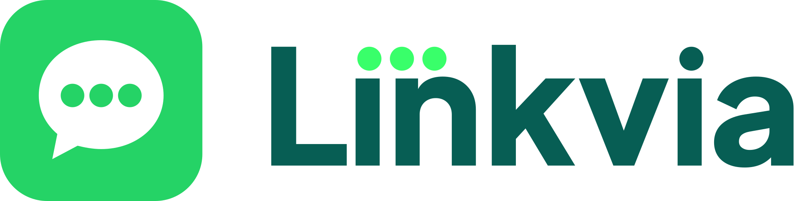

<p align="center"></p>

<h3 align="center">La autopista para desplegar tus agentes.</h3>
<p align="center">WhatsApp te cobra cada mensaje, nosotros no.</p>

---

**Linkvia** es una app de chat igual a WhatsApp en la que del otro lado contesta el agente de un negocio. Vos conectás tu bot por webhook y el negocio paga **por conversación**, no por cada mensaje que manda el bot.

Desde octubre de 2026, Meta cobra cada respuesta de un bot de WhatsApp después de las primeras 1.000 del mes. Un agente que toma pedidos manda 6 a 12 mensajes por charla, así que la cuenta crece rápido. Con Linkvia, el mismo agente atiende sin esa factura.

## Por qué conectar tu agente acá

- **Un argumento para vender:** le mostrás a tu cliente cuánto se ahorra frente a WhatsApp.
- **Sin comisiones** sobre lo que cobrás por tus proyectos.
- **Todo lo de WhatsApp Business:** botones, listas, carrusel, catálogo, fotos, PDF, ubicación, audios, tildes, "escribiendo…".
- **Y lo que WhatsApp no tiene:** respuestas que se escriben de a partes (streaming, como ChatGPT), monitoreo cada 5 minutos con aviso si tu bot se cae, y datos del cliente solo con su permiso.
- **Una persona del negocio puede entrar a la charla:** si tu bot pide ayuda (`handoff`) o el negocio quiere atender en persona, alguien toma la conversación desde el panel, contesta con su nombre y después se la devuelve a tu bot, que recibe el aviso `handback` para ponerse al día.
- **Si tu bot ya habla con la API de WhatsApp, anda sin reescribirlo:** Linkvia manda el mismo JSON y la misma firma que Meta.

## Empezá en 5 minutos

1. Registrá el negocio en [linkvia.optis.site/#/negocios](https://linkvia.optis.site/#/negocios) y guardá el secreto del webhook.
2. Copiá un bot de ejemplo y arrancalo:

   ```bash
   LINKVIA_WEBHOOK_SECRET=whsec_... node ejemplos/node/bot.mjs
   # o
   LINKVIA_WEBHOOK_SECRET=whsec_... python3 ejemplos/python/bot.py
   ```

3. Hacelo público (por ejemplo con `cloudflared tunnel --url http://localhost:4000`) y poné esa dirección como webhook.
4. Abrí `https://linkvia.optis.site/@tu_handle` y escribí "hola".

La guía paso a paso está en **[docs/empezar-en-5-minutos.md](docs/empezar-en-5-minutos.md)**.

## Qué hay en este repositorio

| | |
|---|---|
| [docs/empezar-en-5-minutos.md](docs/empezar-en-5-minutos.md) | Guía corta, de cero a tu agente contestando |
| [docs/conectar-un-bot.md](docs/conectar-un-bot.md) | Referencia completa: eventos, acciones, firma, API, modo asíncrono para IA, streaming |
| [docs/whatsapp.md](docs/whatsapp.md) | Traer un bot hecho para la API de WhatsApp sin reescribirlo |
| [docs/telegram.md](docs/telegram.md) | Linkvia frente a Telegram, y cómo llevar un bot de Telegram |
| [docs/linkvia-para-tu-ia.md](docs/linkvia-para-tu-ia.md) | El contrato resumido para pasarle a Claude, ChatGPT o Cursor y que te escriba el bot |
| [ejemplos/node/bot.mjs](ejemplos/node/bot.mjs) | Bot mínimo en Node 18+, sin dependencias |
| [ejemplos/python/bot.py](ejemplos/python/bot.py) | Bot mínimo en Python 3.9+, sin dependencias |
| [plantillas/](plantillas/) | **Agentes listos para vender** a negocios: turnos de belleza, gastronomía con delivery y take away, canchas y clases. Con panel, seña y cobro |
| [casos/](casos/) | **Ideas de agentes de consumo** con cómo cobrarlos: vencimientos, gastos, inglés, lista de compras y más |
| [docs/cobrar-con-mercado-pago.md](docs/cobrar-con-mercado-pago.md) | Cómo cobra tu agente con la cuenta de Mercado Pago del negocio |

Próximamente: plantillas para n8n, Make y Botpress, y un ejemplo con un modelo de IA.

## Vendé tu agente

Armá un agente una vez y vendéselo a muchos negocios iguales por una cuota mensual. Un local chico entra en el plan Free de Linkvia, así que lo que cobrás es casi todo margen. Empezá por una [plantilla](plantillas/): cambiás el `config.json` con los datos del negocio, lo probás con el simulador y lo conectás. Si querés que tu agente aparezca en la [Agent Store](https://www.linkvia.com.ar/agent-store.html), escribinos. Más en [Ganá dinero con tus agentes](https://www.linkvia.com.ar/emprendedores.html).

## Cómo funciona, en un vistazo

```
Cliente en Linkvia ──► Linkvia ──POST firmado──► tu webhook
                                ◄── { "actions": [...] } ──┘
```

```json
{ "contractVersion": "0", "actions": [
  { "type": "text", "text": "¡Hola! ¿Qué te preparamos?" },
  { "type": "buttons", "text": "¿Delivery o retiro?", "buttons": [
    { "id": "delivery", "title": "Delivery" }, { "id": "retiro", "title": "Retiro" } ] }
] }
```

## Planes para el negocio

| Free | Pro | Enterprise |
|---|---|---|
| USD 0 | USD 19 por mes | USD 149 por mes |
| 300 conversaciones por mes | 2.000 conversaciones, después USD 0,01 cada una | 20.000 conversaciones, después USD 0,005 cada una |

Una conversación empieza cuando el cliente escribe después de 24 horas sin hablar. Lo que el agente conteste en esa charla no suma.

**Para creadores** de agentes con suscriptores que los usan todos los días (inglés, vencimientos, gastos): plan **Creador**, USD 0,08 por persona activa al mes, mínimo USD 15. Mide personas en lugar de conversaciones. Está en camino; mientras tanto se aplican los planes de arriba.

## Preguntas frecuentes

**¿Por qué elegir Linkvia en vez de Telegram?**
Porque los clientes del negocio no tienen que instalar ni pagar nada. En Argentina, para mandar el código de verificación por SMS, Telegram le pide al usuario que pague una semana de Telegram Premium con tarjeta desde Google Play, y muchos abandonan ahí. Y para que el bot atienda desde la cuenta del propio negocio (Telegram Business), el negocio tiene que pagar Telegram Premium todos los meses. En Linkvia el cliente nunca paga, el negocio arranca gratis y los clientes entran desde el link del negocio, el código les llega gratis y la app se usa igual que WhatsApp. Además, cada negocio está verificado, los datos del cliente llegan solo con su permiso y Linkvia avisa si el bot deja de responder. Más detalle y cómo llevar un bot de Telegram en [docs/telegram.md](docs/telegram.md).

**¿Tengo que dejar WhatsApp o Telegram?**
No. El mismo agente puede atender en los tres lados; cambia solo la capa que habla con cada mensajero.

## Ayuda

¿Encontraste un error en la documentación o te falta un ejemplo? [Abrí un issue](../../issues). Para lo demás, escribinos a hello@taskia.site.

Los ejemplos de este repositorio tienen licencia MIT: copialos y usalos en tus proyectos, también comerciales.
